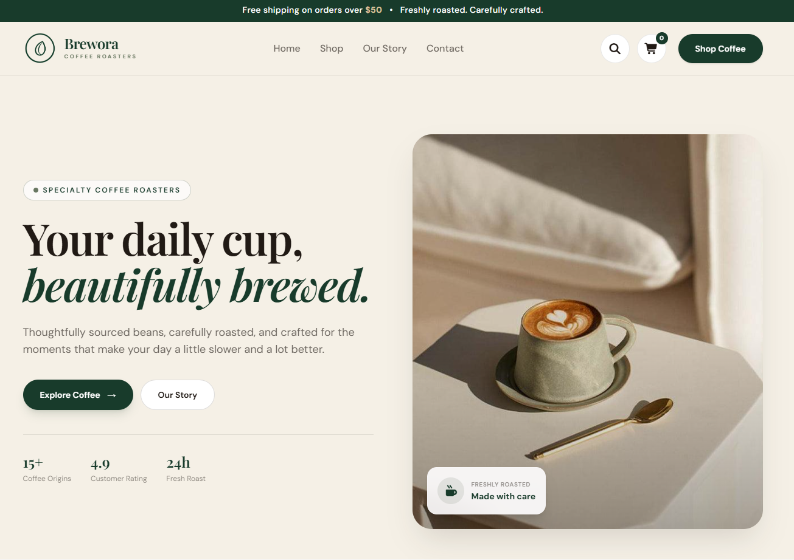
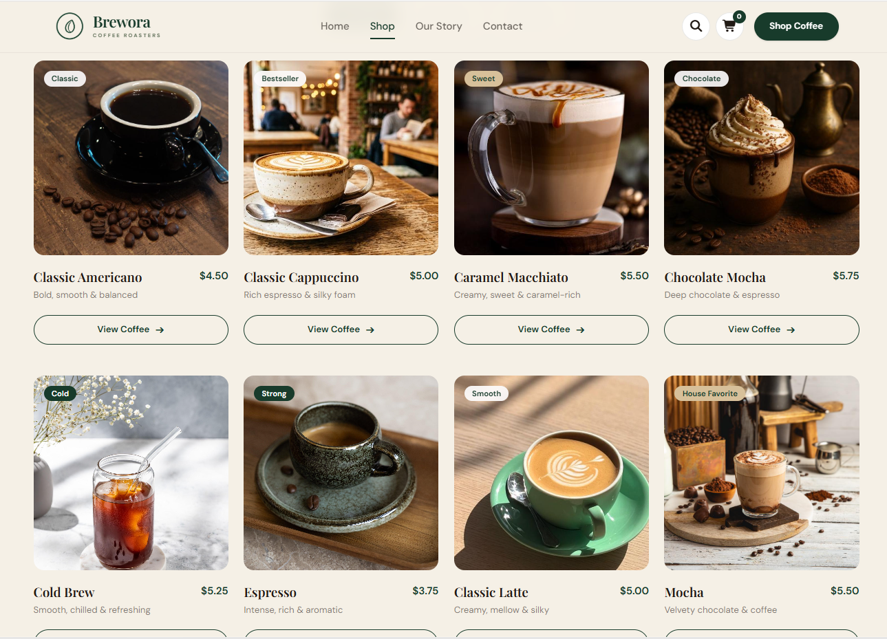

# ☕ Brewora — Specialty Coffee

<div align="center">

### A little coffee. A lot of comfort.

A modern and responsive specialty coffee website designed to bring a smooth and enjoyable coffee-shopping experience to the web.

**[View Live Website](https://aysprog.github.io/Brewora-Specialty_Coffee/)**

</div>

---

## About the Project

**Brewora** is a frontend web development project built around a specialty coffee shop concept.

The website combines a warm visual identity with a clean layout, responsive design, and interactive shopping features.

Its design uses a carefully selected palette of forest green, sage, cream, and warm coffee tones to create a welcoming coffee-shop atmosphere.

## Features

- Responsive website layout
- Modern coffee-shop inspired design
- Product browsing interface
- Interactive shopping cart
- Product details and filtering
- Dedicated shop page
- Consistent styling across sections

## Technologies Used

| Technology | Purpose |
|---|---|
| HTML5 | Website structure |
| Tailwind CSS | Styling and responsive layouts |
| CSS3 | Custom styling |
| JavaScript | Interactive functionality |

## Design Palette

| Color | Hex |
|---|---|
| Forest Green | `#183B2B` |
| Sage | `#687761` |
| Cream | `#F5F0E6` |
| Coffee | `#76543D` |
| Espresso | `#211A15` |
| Gold | `#C69A6B` |

---

## Website Preview

### Homepage



### Shop Page



---

## Project Structure

```text
coffee/
│
├── img/
├── screenshots/
│   ├── coffee-homepage.png
│   └── coffee-shop.png
│
├── index.html
├── shop.html
├── script.js
└── custom.css
```

## Getting Started

To run Brewora locally:

1. Clone or download this repository.
2. Open the project folder in your code editor.
3. Open `index.html` using your browser or Live Server.

## Purpose

This project is part of my frontend development learning journey, where I practice responsive web design, styling, and JavaScript-based interactivity.

---

<div align="center">

**Brewora | Specialty Coffee**

*Designed and developed by Ayesha Athar.*

</div>
